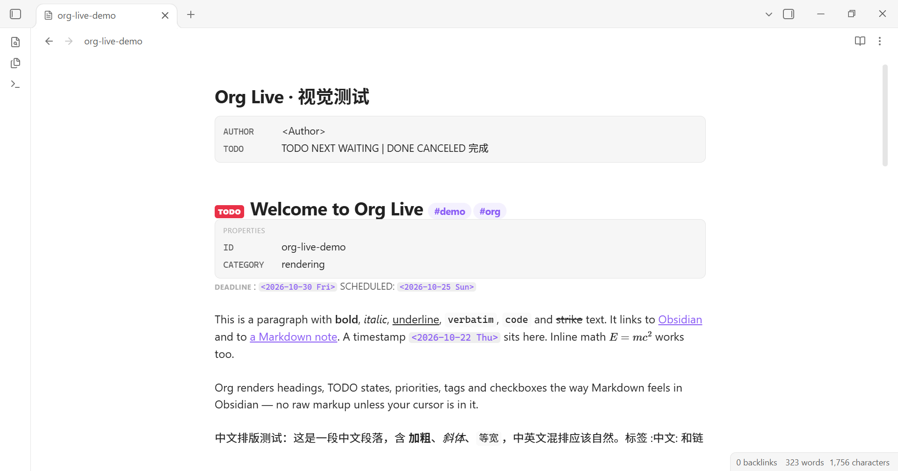
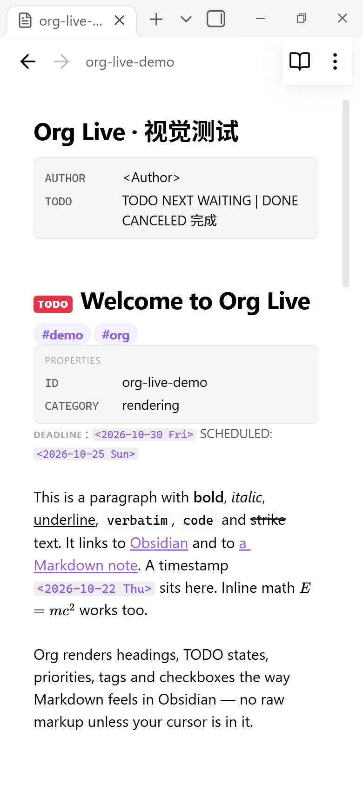
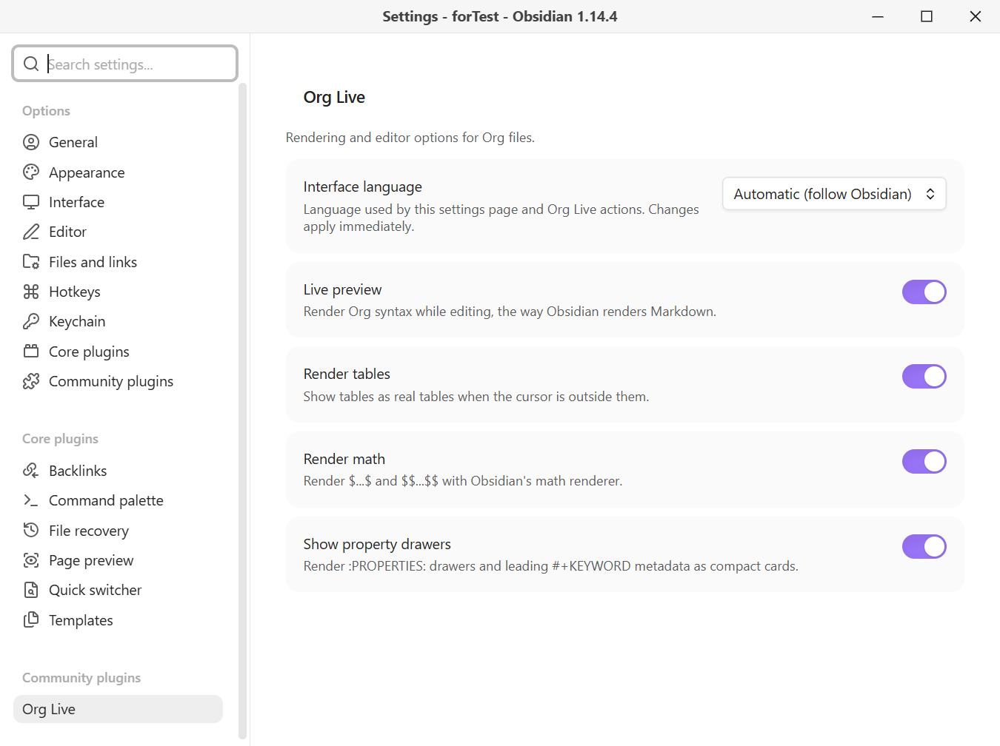
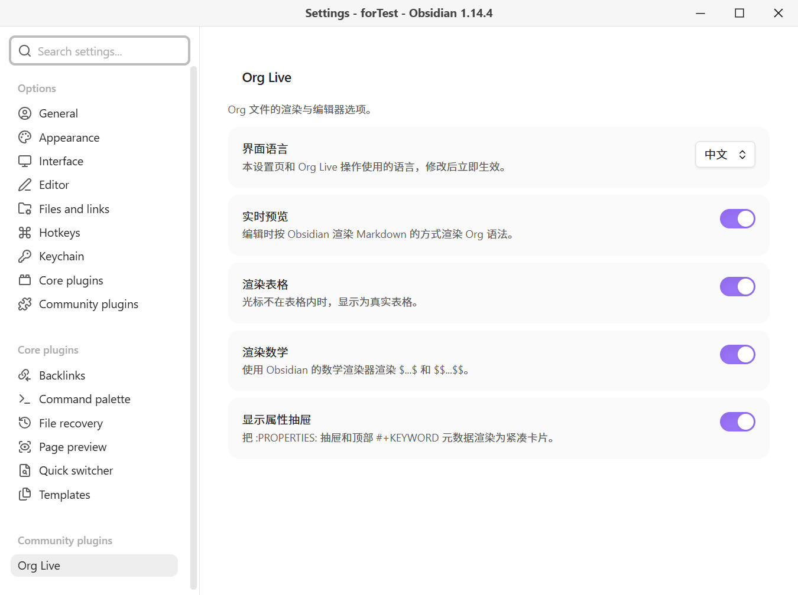
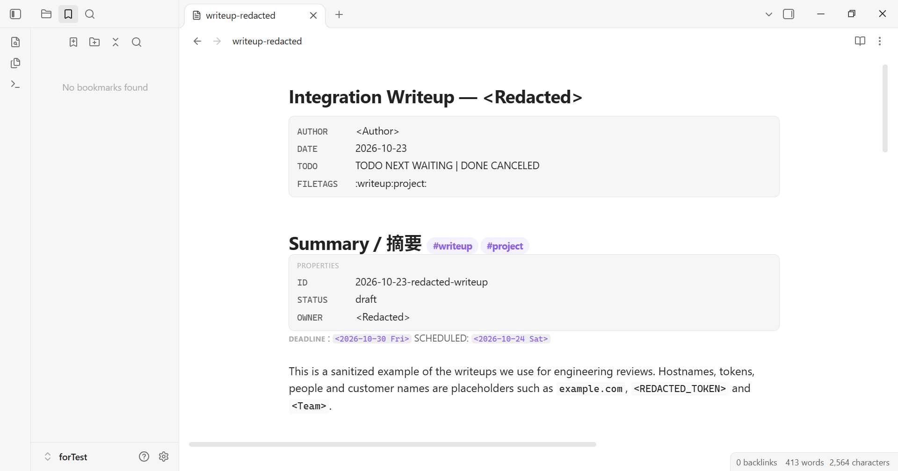

# Org Live

[English](README.md) | [中文](README.zh-CN.md)

Org Live 让 Obsidian 原生打开、编辑和阅读 `.org` 文件，并尽量复用 Obsidian Markdown 的实时预览与阅读视图视觉。它不另造一套视觉系统，而是直接使用 Obsidian 自己的 Markdown/CM6 类名，因此当前主题会以同样的方式渲染标题、代码、标签、表格和链接。



## 特性

- **原生 `.org` 文件类型**：插件自己注册扩展，不需要 UNITADE 或其他“扩展接管”插件。
- **实时预览**：光标不在某处时隐藏 Org 标记，像 Markdown 一样渲染；光标进入时恢复可编辑原文。
- **阅读视图**：视图右上角的书本/铅笔按钮切换。
- **结构**：标题、TODO/自定义 TODO 关键字、优先级、标签、计划行、属性抽屉、`#+KEYWORD` 元数据、表格、代码/引用/示例/居中/verse 块、注释、固定宽度、水平线。
- **内联语法**：粗体、斜体、下划线、verbatim、行内代码、删除线、链接、裸 URL、时间戳、脚注引用、cookie、数学。
- **交互**：复选框点击并保存、内部链接、标签搜索、表格单元格点击回到原文、TODO 循环、列表续行与缩进。
- **双语设置**：自动 / English / 中文。命令名称和视图操作标签会即时更新。
- **移动端**：`isDesktopOnly: false`；iOS 使用原生选择；安全区/工具栏留白；触摸尺寸复选框；表格横向滚动；代码按 Markdown 实时预览的方式折行。
- **中文友好**：Unicode 标签（`:中文:测试:`）、自定义中文 TODO 关键字（`#+TODO: 待办 | 完成`）、CJK 强调边界。

## 与 Markdown 的视觉互通

| Org | 复用的 Obsidian / Markdown 结构 |
| --- | --- |
| 标题层级 | `HyperMD-header-N`、`cm-header-N` |
| 粗体/斜体/删除线/行内代码 | `cm-strong`、`cm-em`、`cm-strikethrough`、`cm-inline-code` |
| 链接 | `cm-hmd-internal-link`、`cm-link` + `cm-underline` |
| 列表/复选框 | `HyperMD-list-line-N`、`cm-list-N`、`list-bullet`、`task-list-item-checkbox` |
| 引用 | `HyperMD-quote`、`cm-quote` |
| 代码块 | `HyperMD-codeblock`、`code-block-flair`、Prism token 类 |
| 表格 | `cm-embed-block cm-table-widget markdown-rendered` |
| 标签 | `cm-hashtag` / 阅读视图 `<a class="tag">#tag</a>` |
| 数学 | Obsidian `renderMath` + MathJax |
| 阅读视图 | `.markdown-preview-view.markdown-rendered`、`inline-title` |

Org 特有概念（TODO、优先级、计划行、抽屉/元数据卡片、时间戳、固定宽度、注释）使用少量基于主题变量的自定义样式。

## 安装

### BRAT（推荐，尤其适合手机）

1. 从 Obsidian 社区插件安装 **BRAT**。
2. 在 BRAT 中选择 **Add Beta Plugin**，输入：
   ```
   zzeitt/obsidian-org-live
   ```
3. 在设置 → 第三方插件中启用 **Org Live**。
4. 禁用其他接管 `.org` 的插件（例如 **Orgmode cm6**）。一个扩展只能由一个插件拥有；Org Live 已经自己注册 `.org`，不需要 UNITADE。

需要 Obsidian **1.8.7+**（使用公开的 `getLanguage()` API）。支持 iOS/Android。

### 手动安装

把 `main.js`、`manifest.json`、`styles.css` 复制到：

```
<vault>/.obsidian/plugins/org-live/
```

然后启用 **Org Live**，并禁用冲突的 `.org` 插件。

## 移动端 / iOS

视图是 `TextFileView` + 内嵌 CodeMirror 6，可在 Obsidian 移动端使用：

- iOS/Android 使用原生文本选择和选择手柄；桌面保留 CM6 自绘光标。
- 内容考虑 `safe-area-inset-bottom` 和移动端工具栏高度。
- 复选框/标签触摸目标放大；表格横向滚动；长代码按 Obsidian Markdown 实时预览的方式折行。
- 视图头部的书本/铅笔按钮和所有命令在移动端可用。

已使用 390×844 视口模拟和移动端 CSS 验证；仍建议在真实 iOS 设备上验收。截图在 `shots/mobile-*.png`。



## 双语设置

设置 → Org Live → **界面语言**：

- **自动（跟随 Obsidian）**
- **English**
- **中文**

整个设置页、阅读视图操作标签和三个命令都会本地化。切换语言后当前会话立即生效。

| English | 中文 |
| --- | --- |
|  |  |

## 使用

- 在文件管理器点击任意 `.org` 文件。
- 右上角 **书本** 图标进入阅读视图，**铅笔** 图标回到实时预览。
- 命令：
  - `Org Live: 切换阅读视图`
  - `Org Live: 循环切换 TODO 状态`
  - `Org Live: 进入实时预览`
- 设置：
  - 界面语言
  - 实时预览
  - 渲染表格
  - 渲染数学
  - 显示属性抽屉 / 顶部 `#+KEYWORD` 元数据

可以把 `Toggle reading view` 绑定到与 Markdown 阅读视图相同的快捷键（常见为 `Ctrl/Cmd+E`）。

## 脱敏 writeup

`test/writeup-redacted.org` 是一份贴近真实工程复盘的 writeup，**所有主机、token、人名、客户名都替换为占位符**（`example.com`、`<REDACTED_TOKEN>`、`<Team>`、`<Redacted>`）。覆盖标题、TODO、优先级、标签、属性抽屉、元数据、列对齐表格、长 URL、长代码行、引用、数学、中文、嵌套任务列表、脚注。



这份 writeup 的渲染实测发现并修复了：

- Org `<l>|<c>|<r>` 列对齐行被当成数据行。
- Live 表格 widget 缺少单元格内边距。
- 窄屏下代码块语言标签与折行代码重叠。
- 强制代码不折行导致整个编辑器出现横向滚动条（Obsidian Markdown 实时预览本身会折行）。

## 已知限制

- Obsidian 的 metadata cache 不公开写入非 Markdown 文件，因此 **大纲、反链、关系图、标签面板不会索引 Org 的标题/链接/标签**。点击标签使用 `:tag:` 原文搜索。
- 尚未实现标题折叠指示器。
- 实时预览中的表格是只读渲染；点击单元格回到原文编辑。
- 脚注定义目前按行内文本显示，不汇总为脚注区。
- 不是完整 Org：不处理 Babel、`#+INCLUDE`、宏、agenda、导出后端。
- 移动端布局通过视口模拟验证；如遇 iOS 键盘/选择问题请反馈。

## 开发

```bash
npm install
npm run check     # TypeScript
npm run build     # main.js
ORG_TEST_VAULT="/path/to/TestVault" npm run deploy
```

`npm run deploy` 会构建、复制插件到测试 vault、只启用 `org-live`，并复制测试语料。它不会硬编码任何 vault 路径。

视觉验证使用 Obsidian 的 Electron 远程调试：

```bash
# 以 --remote-debugging-port=9222 启动 Obsidian
node scripts/cdp.mjs --open org-live-demo.org --mode live --shot shots/out.png
node scripts/cdp.mjs --mode preview --shot shots/reading.png
node scripts/cdp.mjs --target Settings --shot shots/settings.png
node scripts/cdp.mjs --mobile --shot shots/mobile.png
node scripts/cdp.mjs --info
```

测试资料：

- `test/org-live-demo.org` — 覆盖面较广的语法语料。
- `test/markdown-reference.md` — Markdown 对照笔记。
- `test/writeup-redacted.org` — 脱敏 writeup / 回归语料。
- `docs/visual-verification.md` — 验证记录与截图。
- `docs/superpowers/specs/2026-10-23-org-live-design.md` — 架构与设计决策。

## 参考

实现方式参考了已有的 Obsidian 标记语言插件：

- [dzruyk/obsidian-asciidoc](https://github.com/dzruyk/obsidian-asciidoc) — `TextFileView` + 内嵌 CM6，以及 patched CodeMirror 注意事项。
- [azyarashi/obsidian-typst-mate](https://github.com/azyarashi/obsidian-typst-mate) — 自定义文本视图、CM6 编辑器、阅读/源码切换。
- [Obsidian Decorations 文档](https://docs.obsidian.md/Plugins/Editor/Decorations) — ViewPlugin vs StateField。
- [CodeMirror block decoration 讨论](https://discuss.codemirror.net/t/block-decoration-error-uncaught-rangeerror-block-decorations-may-not-be-specified-via-plugins/4102)。

## License

MIT
